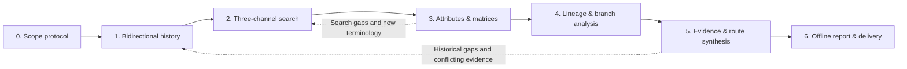

# Research History Mapper

**Do not just collect papers. Reconstruct how a field came to be.**

A reusable Claude Code skill for tracing the intellectual history of a research area: its foundational questions, methods, branching schools, cross-field influences, decisive experiments, contradictions, and unresolved problems.

[](LICENSE)
[](SKILL.md)

---

## Why this skill?

A conventional literature review often answers **“What papers exist?”** but leaves the harder questions unresolved:

- Which paper introduced the problem, and which one changed its meaning?
- Did a later method actually inherit an earlier method, or merely use it as a baseline?
- Why did a research branch emerge, split, disappear, or return years later?
- When two papers disagree, are they really comparable?
- Which gaps follow from evidence, and which are only empty cells in a search result?

**Research History Mapper turns a collection of publications into an evidence-linked development map.** It helps you move from isolated paper summaries to a coherent explanation of how ideas evolved.

Use it when you want to understand a field deeply enough to explain it, teach it, critique it, or choose a defensible research direction.

## What it does

- **Builds a bidirectional historical skeleton** from recent representative work back to its origins, and from foundational theories forward to current research.
- **Searches through complementary channels**: core-topic queries, cross-disciplinary ancestor searches, citation snowballing, and venue inspection.
- **Organizes papers with eight research attributes** and three research-space matrices.
- **Separates research targets, inputs, controls, and baselines**, including papers where the same variable plays different roles in different experiments.
- **Creates Experiment Skeletons** when a paper contains multiple designs whose results should not be collapsed.
- **Reconstructs methodological relationships** without confusing citations, reuse, improvement, baselines, and refutations.
- **Uses citation Main Path Analysis as a discovery aid**, with dual-network comparison and explicit checks for branches outside the main path.
- **Generates evidence-linked offline deliverables**: an evolution map, interactive matrices, paper cards, and a structured survey report.

## A different kind of literature map

| Typical paper collection | Research History Mapper |
| --- | --- |
| Chronological list of papers | Problem-driven historical routes |
| Method names and performance tables | Methods connected to questions, assumptions, and evidence |
| Citation implies inheritance | Citation context, formulas, and experiments determine the relationship |
| One label per paper | Experiment-level distinctions when conditions change the conclusion |
| Main-path citations dominate | Origins, branches, interruptions, and fusions are checked separately |
| “No papers found” | The searched sources, terms, dates, and limits remain visible |
| Static reading notes | Linked registry, evidence cache, matrices, graph, and report |

## The seven-stage workflow



### 0. Scope protocol

Define the research object, core tasks, inclusion boundaries, publication types, languages, cutoff date, and version rules. Keep foundational theories and historical bridges without letting the scope expand indefinitely.

### 1. Bidirectional historical skeleton

Trace recent representative papers backward, then follow foundational concepts, methods, and domain applications forward. Record terminology, known contacts, parallel lines, and candidate turning points.

### 2. Three-channel search

Combine core-topic queries, ancestor and cross-field searches, backward/forward citation snowballing, and venue inspection. Preserve queries, returned records, pagination, version aliases, deduplication decisions, and exclusion reasons.

### 3. Attributes and research-space matrices

Code each study with eight attributes and generate:

1. **Research question × method family**
2. **Research target × information type**
3. **Historical period × research branch**

Important empty cells trigger targeted searches rather than immediate claims of absence.

### 4. Lineage and branch analysis

Build an evidence-backed graph of improvement, method reuse, cross-route fusion, baseline comparison, refutation or boundary correction, and parallel development. Check every major route for **origin, branching, interruption, and fusion**.

### 5. Evidence and route synthesis

Explain what changed, why it changed, what evidence supports it, and where it fails. Separate author claims, reported results, and your synthesis. Read milestone and contradictory papers in depth while keeping the wider corpus structured.

### 6. Offline delivery

Generate a coherent report and evidence-linked views from the same display snapshot. Verify that graph nodes, matrix cells, paper cards, and report claims lead back to the correct source and version.

## What you get

A typical output directory contains:

```text
protocol_and_notes.md       # Scope, queries, routes, matrices, reading notes, and gaps
paper_registry.csv          # Deduplicated research registry with structured attributes
evolution_edges.csv         # Evidence-backed relationships between papers and concepts
cache/                      # Search returns, sources, experiment records, and decisions
display_snapshot.json       # Shared input for matrices, graph, paper cards, and claims
report.md                   # Full development-history report
offline/                    # Optional interactive HTML and supporting data
```

The result is both **human-readable** and **machine-navigable**: you can read the report linearly or start from a paper, matrix cell, or relationship and trace it back to the evidence.

## Installation

### Personal installation

From the repository root, copy the skill files into your personal Claude Code skills directory.

**macOS / Linux:**

```bash
mkdir -p ~/.claude/skills/research-history-mapper
cp SKILL.md README.md ~/.claude/skills/research-history-mapper/
cp -R references assets ~/.claude/skills/research-history-mapper/
```

**Windows PowerShell:**

```powershell
$target = "$HOME\.claude\skills\research-history-mapper"
New-Item -ItemType Directory -Force $target | Out-Null
Copy-Item SKILL.md, README.md $target
Copy-Item references, assets $target -Recurse
```

The installed structure must contain:

```text
~/.claude/skills/research-history-mapper/
├── SKILL.md
├── references/
└── assets/
```

### Project installation

Place the same directory under `.claude/skills/research-history-mapper/` in your project if the skill should be available only there.

Restart or reload your skill-aware environment if it does not discover newly installed skills automatically.

## Quick start

After installation, describe the field and the historical explanation you need.

**Example 1 — broad field history**

```text
Use research-history-mapper to reconstruct the development history of
retrieval-augmented generation. Trace its conceptual origins, major branches,
fusions with adjacent methods, evaluation disputes, and open problems.
Produce a Chinese report, three research-space matrices, and an evidence-linked
evolution graph.
```

**Example 2 — starting from local papers**

```text
Use research-history-mapper to analyze the papers in my literature folder.
Start with 5–8 recent representative studies, trace their theoretical ancestors,
and distinguish actual method inheritance from ordinary baseline comparisons.
Do not treat a citation as sufficient evidence of inheritance.
```

**Example 3 — comparing conflicting results**

```text
Map the development of text-driven commodity volatility forecasting.
For each major route, preserve differences in target definition, market,
sample period, horizon, information set, baseline, and evaluation metric.
Explain apparently conflicting results through their experimental conditions.
```

### Recommended input

Provide whatever is available:

- research object and core tasks;
- inclusion or exclusion preferences;
- language and cutoff date;
- accessible scholarly sources;
- existing PDFs, notes, bibliographies, or citation exports;
- desired report language and level of detail.

The skill can use available scholarly and web tools for missing background. It should ask when your goals, scope trade-offs, time budget, or delivery preferences materially change the work.

## Eight research attributes

| Attribute | Guiding question |
| --- | --- |
| Research problem and task | What problem is the study actually solving? |
| Research target and definition | What is being explained, predicted, measured, or constructed? |
| Information and data sources | What raw or derived information enters the study? |
| Representation and operationalization | How is information transformed into analyzable variables? |
| Methods and models | What maps inputs to outputs or explanations? |
| Mechanism and theory | Why should the proposed relationship occur? |
| Experimental and data protocol | Under what samples, windows, controls, and versions was it tested? |
| Evidence and evaluation | What results, comparisons, robustness checks, or cases support the claim? |

Targets, inputs, controls, and baselines remain separate fields. This prevents a variable used as an input in one experiment from being mistaken for the target of the whole paper.

## Experiment Skeletons and evidence links

A paper-level row is not enough when a publication contains materially different experiments. The skill can create a lightweight Experiment Skeleton keyed by:

```text
Research object / sample family × Core target definition × Main evaluation design
```

Each experiment record can preserve:

- supported and unsupported horizons or conditions;
- samples, inputs, controls, baselines, and metrics;
- contradictory results and limitations;
- experiment-specific evidence IDs.

Matrices are then aggregated from **experiment-level pairings**, not from arbitrary combinations of paper-level tags.

### Unified identifiers

| Identifier | Purpose |
| --- | --- |
| `paper_id` | Deduplicated research entity |
| `entity_id` | Candidate during retrieval and screening |
| `experiment_id` | Experiment or evaluation unit |
| `evidence_id` | Versioned source passage, formula, table, or coordinate |
| `edge_id` | Concept, semantic, candidate, or citation relationship |
| `snapshot_id` | Shared input for all generated views |

Edge prefixes keep layers distinct: `SK` for concept skeletons, `E` for verified semantic edges, `CE` for candidate edges, and `CIT` for raw citation edges.

## Citation Main Path Analysis

When citation structure can clarify the field, the skill supports:

- **Bibliometrix** for bibliometric preparation and historical direct-citation networks;
- **Pajek or `mpaR`** for SPC/SPLC global and key-route main paths;
- comparison of a **core-only network** with a **core + necessary ancestors** network.

Main paths are treated as **candidate historical explanations**, not proof of inheritance. Low-citation work, recent papers, isolated nodes, equivalent best paths, and branches outside the main path still require direct investigation.

## Offline deliverables

The display specification supports:

- a Q/M/P evolution map with branch and time layouts;
- three interactive research-space heatmaps;
- paper cards with experiment conditions and evidence states;
- toggles for raw citations and MPA overlays;
- filters for period, branch, target, relationship, and evidence strength;
- keyboard-accessible node and edge lists;
- relative links to local sources or stable external identifiers.

Large datasets can be split into a lightweight single-file viewer and a full archive. Reducing the viewer must not remove the archived evidence or experiment links.

## Evidence principles

Research History Mapper is built around a few non-negotiable distinctions:

1. **Discovery is not confirmation.** Search and citation results nominate relationships; source text confirms them.
2. **A baseline is not an ancestor.** Method reuse requires evidence of actual reuse.
3. **Versions matter.** Do not transfer page or table references between preprints and journal editions without checking them.
4. **Conditions matter.** Preserve differences in target, sample, horizon, controls, baseline, and evaluation metric.
5. **Absence needs a search boundary.** A matrix gap is not proof that no research exists.
6. **Negative results belong in the history.** Failed replications and boundary papers often explain a field better than its most-cited successes.

The goal is a complete, explainable development logic chain with explicit unresolved links—not a collection of absolute first-invention or exhaustive-coverage claims.

## Repository structure

```text
.
├── SKILL.md
├── README.md
├── LICENSE
├── references/
│   ├── workflow.md
│   ├── encoding.md
│   ├── experiment-and-evidence.md
│   ├── mpa.md
│   ├── offline-display.md
│   └── evidence-and-reading.md
└── assets/
    ├── protocol_and_notes_template.md
    ├── paper_registry_template.csv
    ├── evolution_edges_template.csv
    ├── experiment_skeleton_template.json
    ├── evidence_record_template.json
    ├── adjudication_record_template.json
    ├── display_snapshot_template.json
    └── report_template.md
```

## Requirements

The core workflow is tool-agnostic and can be used with local files or available scholarly search tools. No Python or R installation is required just to read or adapt the method.

For citation main-path calculations, use your preferred compatible environment with Bibliometrix and either Pajek or `mpaR`. The repository provides the methodological contract, not a mandatory software runtime.

## 中文快速使用

这个技能适合把一个研究方向整理成“问题如何提出—方法如何演进—路线如何分叉与融合—证据在哪些条件下成立—还有哪些问题未解决”的完整发展逻辑链。

安装后可以直接输入：

```text
请用 research-history-mapper 梳理图神经网络用于材料发现的完整发展历史。
从近年代表论文倒推，再从理论源头正推，区分方法继承、方法复用和普通基线比较。
输出中文全景报告、三张研究矩阵、骨干演化边和证据回链。
```

也可以提供本地 PDF、已有综述、参考文献或 BibTeX，让技能从现有材料开始建立历史骨架。

## Contributing

Issues and pull requests are welcome for improvements to:

- domain-neutral research taxonomy;
- experiment and evidence schemas;
- lineage and MPA guidance;
- reusable templates;
- installation and usage documentation.

Keep examples reproducible, state the sources of factual claims, and avoid adding private papers, credentials, or unpublished research records to the public repository.

## License

Released under the [MIT License](LICENSE).
